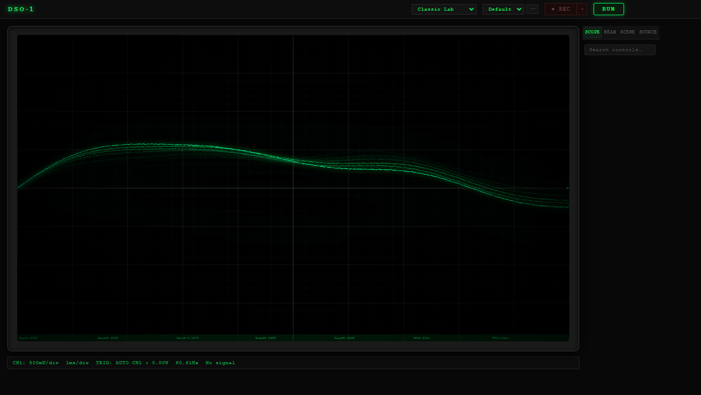

# Sound Lab



A place to see and play with sound: scope, math shapes, sound toys.

## Install

Download a built app from the [GitHub Releases page](https://github.com/HesNotTheGuy/sound-lab/releases).

From source:

```bash
npm install
npm start
```
