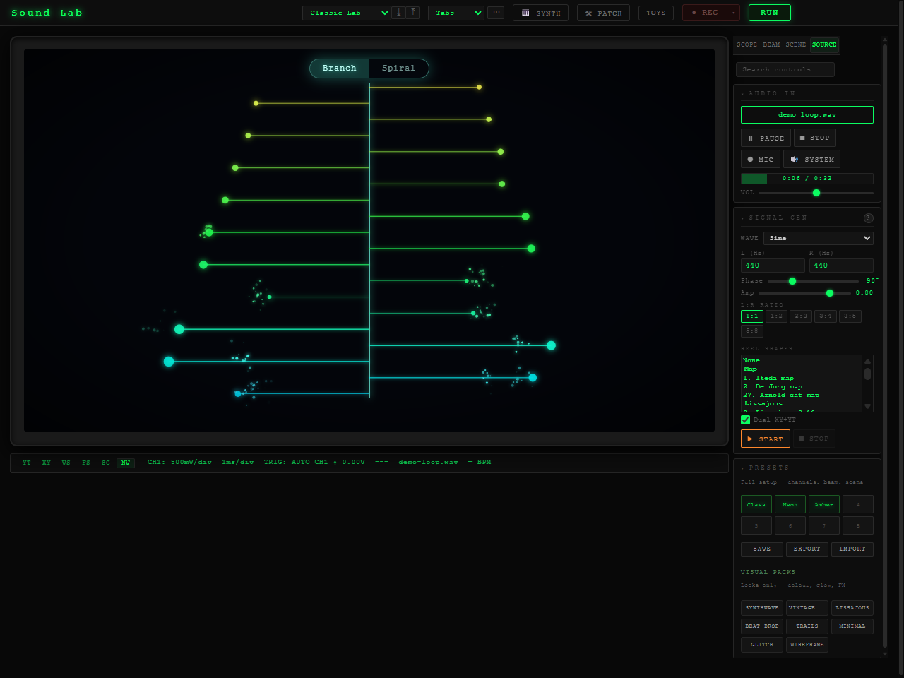
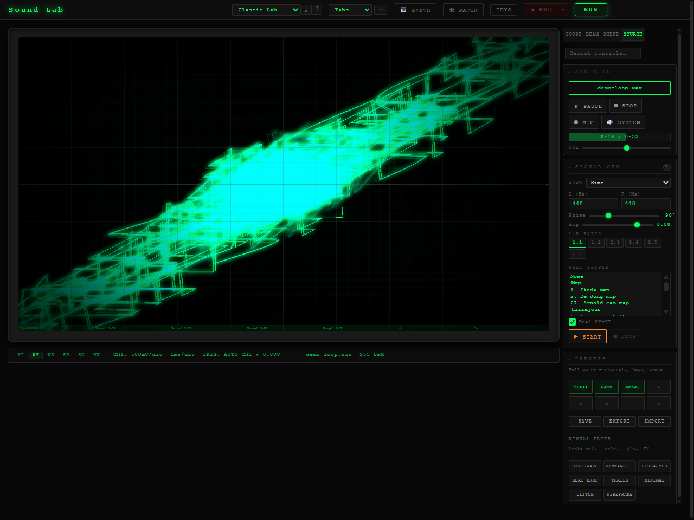
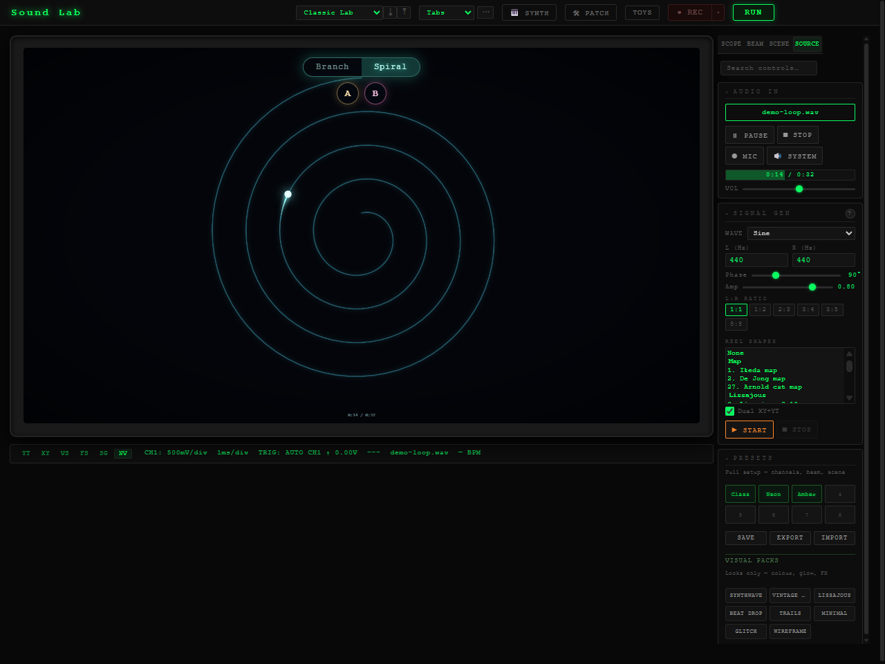
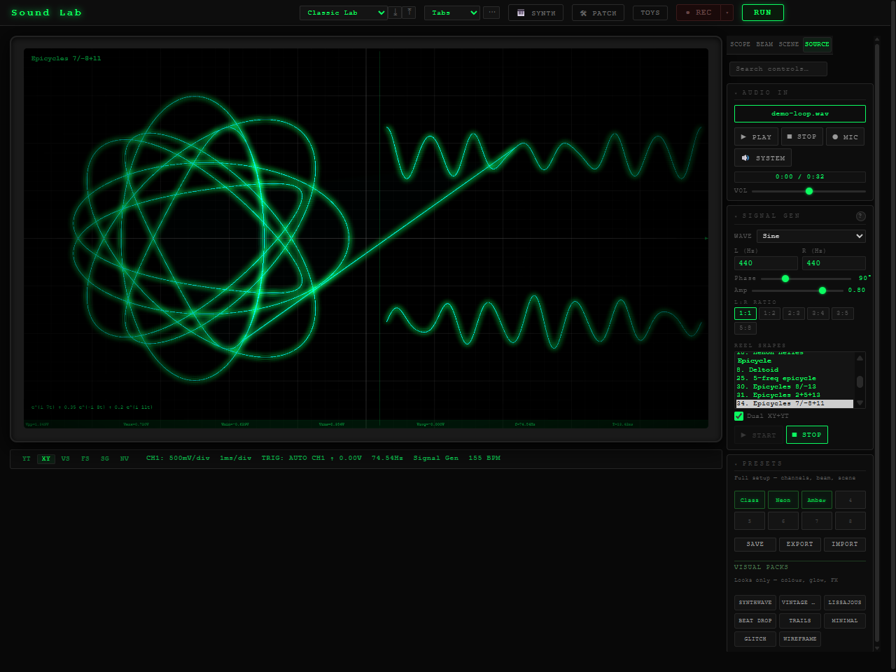
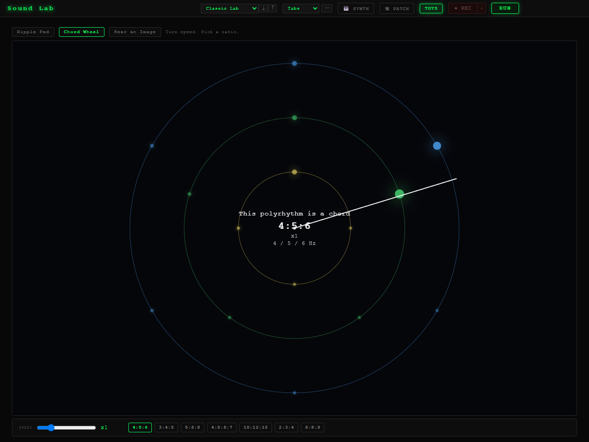
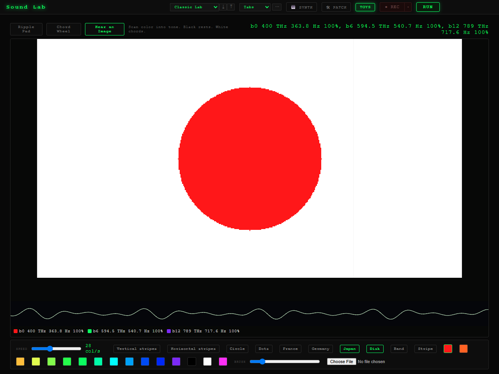
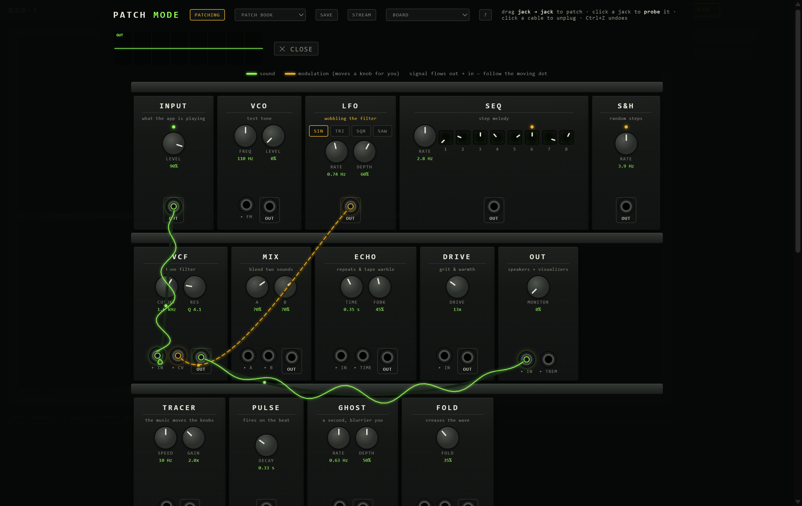

# Sound Lab



**A sandbox for playing with sound and watching what it does to light.**

Sound Lab started life as an oscilloscope: sound goes in, a glowing line comes out. It kept
growing. Now it's a place to mess around. Feed it a song, your mic, whatever your computer is
playing, or noise you patched together yourself, then see how that sound bends the picture.

There's nothing to finish and no right way to use it. Turn knobs, swap views, break things, and
keep whatever looks good. It's made for artists, VJs, musicians and anyone who likes to tinker
and wants a spark for their next idea.

## Bring any sound

Drop in an audio file, turn on the mic, or grab **system audio** to visualize whatever your
computer is already playing. You can also make sound right in the app: a signal generator, a
keyboard synth, a rack of patchable modules, and a shelf of sound toys.

## Many ways to look at it



The same sound looks completely different depending on how you look at it.

- **Scope (YT).** The classic waveform, with glow, afterglow and CRT curvature.
- **XY.** Left channel against right. Stereo music turns into tangled light, and pure tones
  turn into Lissajous figures.
- **Neon tree (NV).** *Branch* splits the sound into frequency bands that grow like limbs.
  *Spiral* coils the whole song into a timeline you can mark with A and B points.
- **Spectrum, spectrogram and vectorscope** for the more technical view.

<table>
  <tr>
    <td></td>
    <td></td>
  </tr>
  <tr>
    <td align="center">Branch: bass at the bottom, highs at the top</td>
    <td align="center">Spiral: the song as a coil</td>
  </tr>
</table>

## Draw with math



The **reel** holds 50 shapes: knots, roses, epicycles, strange attractors, Gielis supershapes
and more. Each one is built from a pair of audio signals, one for left and one for right. Pick
one and the figure draws itself, with the two waveforms that make it running alongside. That
pairing shows how a shape and a sound are the same thing.

## Sound toys

Small instruments that are as much about looking as listening.

- **Ripple Pad.** Tap or drag across a grid and rings spread out, playing notes in whatever
  scale and key you pick.
- **Chord Wheel.** Rings spin at simple ratios like 4:5:6. Slow, it's a polyrhythm. Speed it
  up and the same ratios become a chord.
- **Hear an Image.** A scanner sweeps across a picture and turns color into pitch. Black
  rests, white plays chords. Paint on it, or load your own image.

<table>
  <tr>
    <td></td>
    <td></td>
  </tr>
</table>

## Patch it together



**PATCH** opens a modular rack between your sound and the visuals. Plug in oscillators, filters,
echo, drive, clocks, sequencers and odd modulators like *Drift*, *Ghost* and *Strange*, then
watch the signal travel down each cable. The patch book has ready-made starting points. Try
*groovebox*, a whole song that plays itself with no input at all.

## Make it look like yours

Eleven themes, one-click looks (Synthwave, Glitch, Trails, Wireframe, and more), beam color and
glow, mirrors, rotation, afterglow and bloom. You can also trace 3D models and images in light
and have them float, ripple, twist or explode to the beat.

## Take it somewhere

When something looks good, get it out of the app:

- Record video.
- Pop the display out to a second screen.
- Stream it into OBS or Resolume.
- Drive stage lights over DMX.
- MIDI-map any knob to your controller.

## Things to try

- Play a song, switch to **NV**, and flip between Branch and Spiral.
- Start the signal generator, switch to **XY**, then click through the ratio buttons (1:2, 2:3,
  3:5).
- Pick **Epicycles 7/−8+11** from the reel, then click the **Trails** look.
- In **Hear an Image**, paint white stripes over the picture and listen.
- Open **PATCH**, load *groovebox* from the patch book, and switch scope modes while it plays.

Every control is documented in [docs/FEATURES.md](docs/FEATURES.md).

## Install

Download a build from the [Releases page](https://github.com/HesNotTheGuy/Oscilloscope/releases).

To run from source (Node 22.12 or newer):

```bash
npm install
npm start
```

## License

[CC BY-NC 4.0](LICENSE): free to use, remix and share, but not for commercial use.
